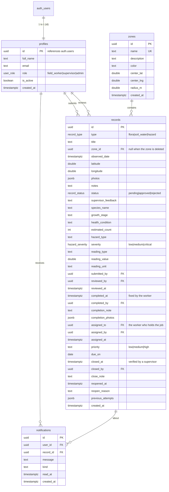

# Database design

The schema lives in [`../supabase/01_schema.sql`](../supabase/01_schema.sql).
Run the SQL files in `supabase/` in numeric order in the Supabase SQL Editor.

## Entity-relationship diagram

## Enums

| Enum | Values |
| --- | --- |
| `user_role` | `field_worker`, `supervisor`, `admin` |
| `record_type` | `flora`, `soil_water`, `hazard` |
| `record_status` | `pending`, `approved`, `rejected` |
| `hazard_severity` | `low`, `medium`, `critical` |

`records.priority` is a plain `text` column with a check constraint
(`low`/`medium`/`high`) rather than an enum: it is a work-order detail that may
gain values, and a check constraint can be widened without a type migration.

## Tables

- **profiles** - one row per account, created automatically by the
  `handle_new_user` trigger whenever someone signs up through Supabase Auth. Holds the
  role and an `is_active` flag (used to deactivate accounts).
- **zones** - the monitoring areas, drawn as circles on the map.
- **records** - every field observation. Flora / soil-water / hazard fields are all in
  the same table; unused columns stay `NULL`.
- **notifications** - created by a trigger when a record is reviewed, and read by the
  mobile app.
- **audit_logs** - an append-only trail written by triggers in `10_audit_logs.sql` when a
  record is created, edited, reviewed, or deleted and when an account changes (role,
  active flag, approval status). Only administrators may read it; nobody can edit or
  delete entries through the API.

## Indexes

`records` is indexed on `zone_id`, `status`, `type`, `observed_date`, `submitted_by`
and `severity` so the dashboard filters stay fast. Two partial indexes cover the
repair loop: `records_assigned_open_idx` (`assigned_to` where the job is not
closed) for "my assigned work", and `records_awaiting_verification_idx`
(`completed_at` where the job is not closed) for the supervisor's queue.

## Functions that enforce the rules

Policies alone cannot express these rules (a reviewer is allowed to update any
record, so the policy cannot tell an assignment from an edit), so each action is a
`security definer` function with the checks inside it:

| Function | File | Who may call it |
| --- | --- | --- |
| `assign_remediation(record, worker, priority, due_on)` | `13_remediation.sql` | supervisors and admins |
| `complete_record(record, note, photos)` | `13_remediation.sql` (rewrites `12_job_completion.sql`) | the assignee, or the submitter when nobody was assigned |
| `verify_close(record, note)` | `13_remediation.sql` | supervisors and admins |
| `reopen_remediation(record, reason)` | `13_remediation.sql` | supervisors and admins |

## Row Level Security rules that matter

| Rule | Where | Effect |
| --- | --- | --- |
| Read records | `02_policies.sql` | any signed-in user sees the whole site |
| Insert as yourself, always `pending` | `02_policies.sql` | nobody can publish an approved record directly |
| Edit while pending | `02_policies.sql` | the owner may fix their own record until it is reviewed |
| Review (approve / reject) | `02_policies.sql` | supervisors and admins |
| Delete any record | `02_policies.sql` | admins |
| Delete your own record **while pending** | `09_delete_own_pending.sql` | field workers can take back a mistake that has not been reviewed |
| Delete photos | `03_storage.sql` | the uploader (their own folder) or an admin |
| Notifications | `02_policies.sql` | each user only ever sees their own |
| Read the activity log | `10_audit_logs.sql` | administrators only; entries are append-only |
| Add or delete a zone | `02_policies.sql` | supervisors and admins; deleting a zone keeps its records, which lose the zone (`01_schema.sql` uses `on delete set null`) |

Deleting a record cascades: its review notifications go with it
(`notifications.record_id ... on delete cascade`), and both apps clear the record's
photos from the `record-photos` bucket at the same time.
