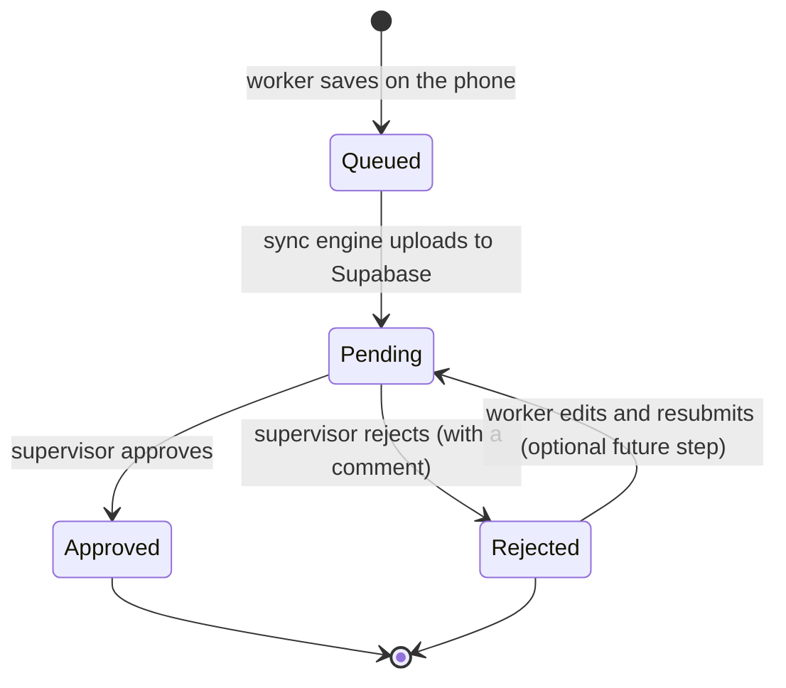
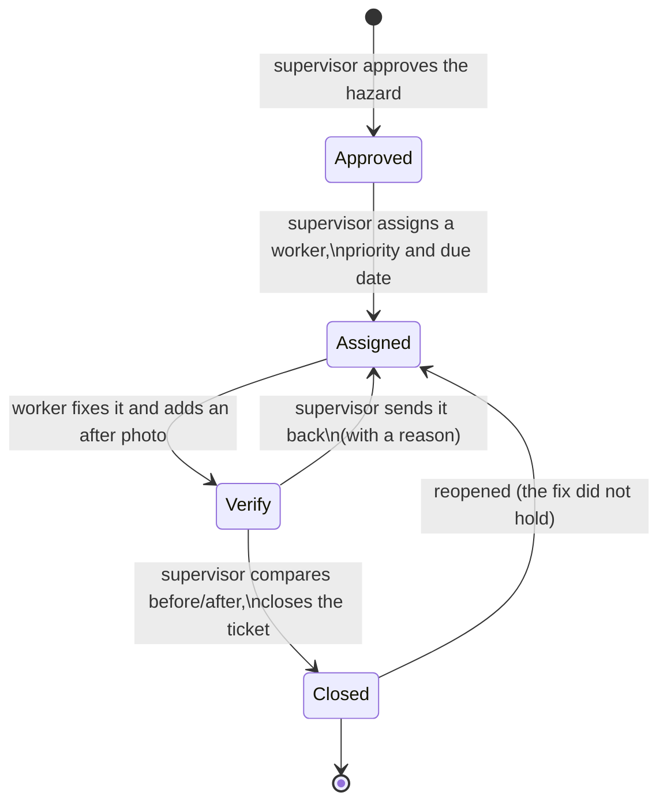
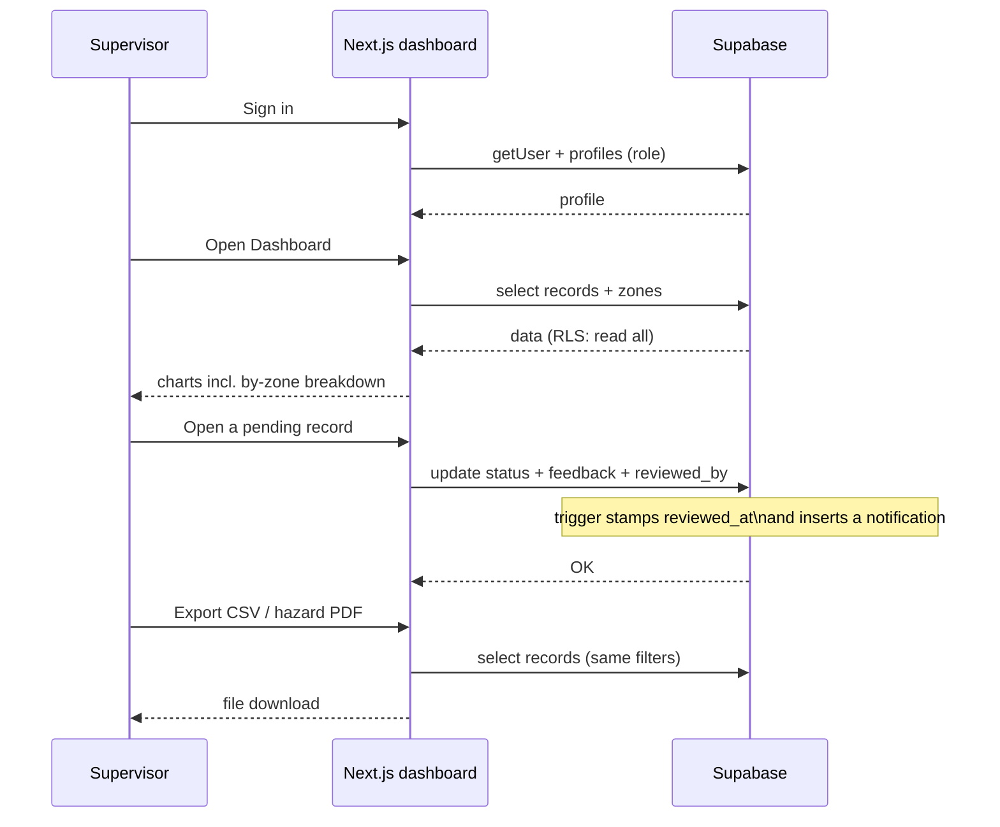

# Workflows and design notes

## Record lifecycle



Notes:
- A record is created as `pending` and can only be inserted by the worker who
  created it (`submitted_by = auth.uid()`), enforced by Row Level Security.
- Approving/rejecting is limited to `supervisor` and `admin`.
- The `notify_record_review` trigger writes a row into `notifications` for the
  submitter. The mobile app re-checks every 20 seconds while it is open and shows a
  phone notification for a review it has not announced yet (unread count on the tab).
- Offline rules on the capture screen: the record and its photos are always written to
  the phone first. "Save as draft" works with no connection (local only); "Save record"
  needs the server, so it is disabled offline with a banner telling the worker to save a
  draft instead. Queued records upload automatically when the connection returns.

## The repair loop (approved hazards)

An approval is a review decision; fixing the hazard is a separate job with its own
lifecycle. Only hazard records have a job: a flora or soil/water record is an
observation and is finished as soon as it is reviewed.



Three moments are kept apart, and only the last one moves the Village Health Score:

| Column | Written by | Meaning |
| --- | --- | --- |
| `assigned_at` | `assign_remediation()` | a supervisor handed the work to someone |
| `completed_at` | `complete_record()` | the worker says it is fixed |
| `closed_at` | `verify_close()` | a supervisor checked the evidence and closed it |

- `supabase/13_remediation.sql` adds `assigned_to`, `assigned_by`, `assigned_at`,
  `priority`, `due_on`, `closed_at`, `closed_by`, `close_note`, `reopened_at`,
  `reopen_reason` and `previous_attempts` to `records`. The review `status` is
  never changed by this loop, so filters, exports, badges and review
  notifications keep working.
- `assign_remediation(p_record_id, p_assignee, p_priority, p_due_on)` is
  security-definer. Only a reviewer may call it, only an approved, unclosed
  hazard can be assigned, and only an active, approved field worker can take it.
  Priority defaults from severity (critical -> high, medium -> medium, else low);
  a due date is optional and never blocks the work, it only flags overdue jobs.
- `complete_record()` now belongs to the **holder** of the job: the assignee, or
  the submitter when nobody was assigned. It still refuses anonymous or inactive
  users, non-hazard records, unapproved records and jobs that are already fixed
  or closed, and it now requires **at least one** after photo (max 3), each in the
  caller's own storage folder.
- `verify_close(p_record_id, p_note)` is reviewer-only and requires a finished
  job. It sets `closed_at`/`closed_by` and is the only action that removes the
  hazard from the health score.
- `reopen_remediation(p_record_id, p_reason)` is reviewer-only. It archives the
  attempt into `previous_attempts` (note, photo paths, who and when, plus the
  reason) before clearing the completion fields, so the job returns to the same
  worker with the reason attached and no photo is orphaned in storage. It works
  on a finished job (send back) and on a closed one (reopen).
- Audit entries: `record.assigned`, `record.completed`, `record.verified` and
  `record.reopened`, all written by `audit_records()`.
- Notifications are plain rows in `notifications` (no push server): one for the
  assignee, one when a fix is verified, one when it is sent back. The mobile app
  translates the three fixed English patterns.
- The web record page shows the **Remediation** card: assignment form, then
  before/after photos side by side, then Verify & close / Send back. The
  dashboard has a reviewer-only **Remediation** block with counts for to assign,
  in progress, awaiting verification and overdue, and the list of fixes waiting.
- The mobile app lists handed-over work under **Assigned tasks** in My records
  (and on the home screen), with priority and due date. The finish screen shows
  the original photo, then the after photos, and the button reads **Mark as
  fixed** - the job stays open until a supervisor verifies it.
- Jobs that were already completed before this migration are backfilled as
  closed, so deploying the loop does not drop the live health score overnight.


## Field worker flow (mobile app)

```mermaid
sequenceDiagram
    participant W as Field worker
    participant App as Expo app
    participant DB as SQLite (on phone)
    participant SB as Supabase

    W->>App: Sign in
    App->>SB: signInWithPassword
    SB-->>App: session + profile

    W->>App: Capture record (type, GPS, photos)
    alt record not finished, or the phone is offline
        App->>DB: Insert into outbox (status = draft)
        Note over App,DB: Nothing is uploaded.<br/>Submit it later from My Records<br/>once there is signal.
    else record complete and online
        App->>DB: Insert into outbox (status = pending)
        App->>SB: Try upload (photos then record)
        alt online
            SB-->>App: OK
            App->>DB: Delete outbox row
        else connection drops mid-save
            App->>DB: Keep row for later
        end
    end

    Note over App,SB: Offline, "Save record" is disabled and the screen<br/>says why; "Save as draft" always works because<br/>it only writes to the phone.
    Note over App,SB: When the connection comes back, the app<br/>uploads everything pending by itself.

    W->>App: Open Notifications
    App->>SB: select notifications (unread)
    SB-->>App: review messages
    Note over App,SB: While the app is open it re-checks every 20s<br/>and raises a phone notification for new reviews;<br/>the tab shows an unread badge.
```

## Supervisor / admin flow (web dashboard)



## Roles and permissions matrix

| Action | Field worker | Supervisor | Admin |
| --- | --- | --- | --- |
| Sign in (mobile + web) | Yes | Yes | Yes |
| Create a record | Yes (own) | Yes (own) | Yes (own) |
| Read all records | Yes | Yes | Yes |
| Approve / reject a record | No | Yes | Yes |
| Assign remediation work (worker, priority, due date) | No | Yes | Yes |
| Mark an assigned hazard as fixed (note + 1-3 after photos) | Yes (if assigned, or own) | Yes (if assigned, or own) | Yes (if assigned, or own) |
| Verify & close a fix, or send it back | No | Yes | Yes |
| Delete a record | Yes (own, while pending) | No | Yes |
| Manage zones | No | No | Yes |
| Manage users / roles / deactivation | No | No | Yes |
| Export CSV / PDF | No | Yes | Yes |

The worker who holds a job is the assignee; when nobody was assigned, it stays
with the submitter so the older one-tap flow keeps working. Everyone else sees
the same card read-only, and only a reviewer can close the ticket - which is the
moment the Village Health Score moves.

## Naming conventions

- Database: `snake_case` tables and columns; enums in singular (`record_type`).
- TypeScript: `PascalCase` for types/components, `camelCase` for functions/variables.
- Files: `PascalCase.tsx` for components and screens, `kebab/camel.ts` for helpers.
