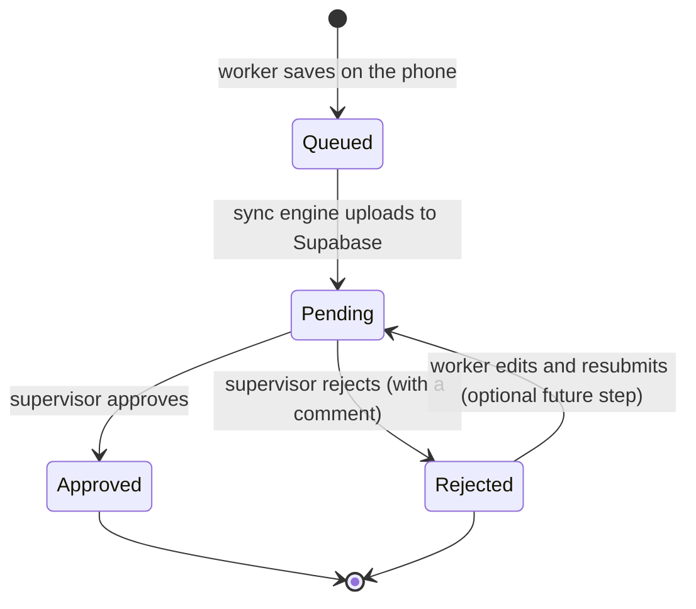
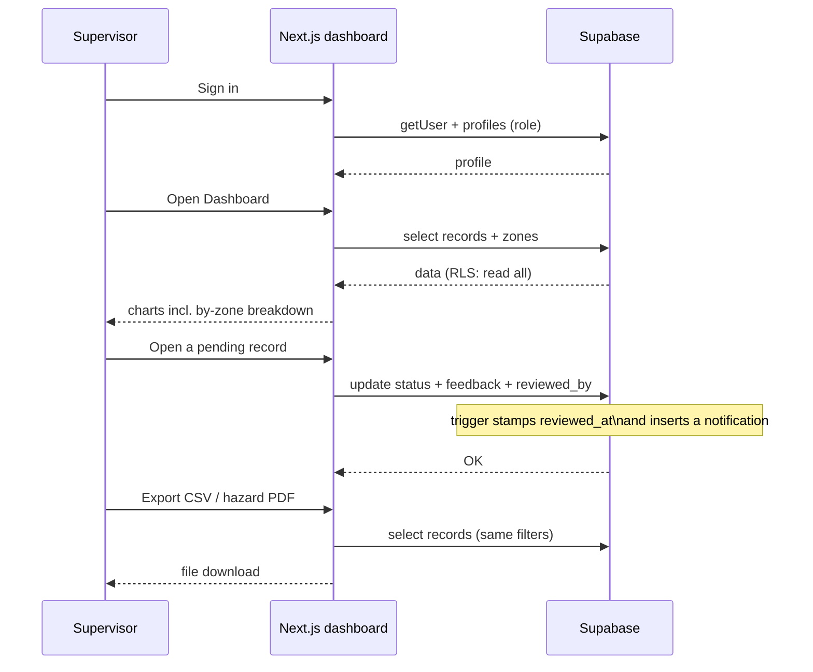

# Workflows and design notes

## Record lifecycle



Notes:
- A record is created as `pending` and can only be inserted by the worker who
  created it (`submitted_by = auth.uid()`), enforced by Row Level Security.
- Approving/rejecting is limited to `supervisor` and `admin`.
- The `notify_record_review` trigger writes a row into `notifications` for the
  submitter. The mobile app re-checks every 20 seconds while it is open and shows a
  phone notification for a review it has not announced yet (unread count on the tab).
- Offline rules on the capture screen: the record and its photos are always written to
  the phone first. "Save as draft" works with no connection (local only); "Save record"
  needs the server, so it is disabled offline with a banner telling the worker to save a
  draft instead. Queued records upload automatically when the connection returns.

## Job completion (approved hazards)

An approval is a review decision; finishing the work is a separate event. Only
hazard records have a job: a flora or soil/water record is an observation and is
finished as soon as it is reviewed.

```mermaid
flowchart LR
    A[Approved hazard] --> B{Completed?}
    B -- no --> C[To do in My records\nFinish job button]
    C --> D[Worker adds a note\nand up to 3 after photos]
    D --> E[complete_record&#40;&#41;]
    E --> F[Completed\nstatus stays approved]
    B -- yes --> F
```



- `supabase/12_job_completion.sql` adds `completed_at`, `completed_by`,
  `completion_note` and `completion_photos` to `records`. The review `status`
  is not changed, so filters, exports, badges and notifications keep working.
- `complete_record(p_record_id, p_note, p_photos)` is a security-definer
  function. It refuses anonymous or inactive users, anyone who did not submit
  the record, non-hazard records, records that are not approved, and records
  that are already complete. It also limits the list to 3 paths and requires
  every path to live in the caller's own storage folder.
- The function accepts only the note and the photo paths, so a worker cannot use
  it to edit the reviewed content (the `protect_columns` trigger also restores
  status and review fields).
- A completion writes one `record.completed` audit entry ("completed the job")
  and does not fire the review notification.
- The worker uploads the after photos first, then calls the function. If the
  call fails, the uploaded files are removed so no orphan is left. Completion
  needs a connection; there is no offline queue for it yet.
- The mobile app lists open jobs under **To do** in My records and keeps them out
  of **Submitted** so the same record is not shown twice. The record's own
  screen shows the **Work** card, a **Completed** pill, the note and the after
  photos. Supervisors see the same card read-only on the web dashboard.


## Field worker flow (mobile app)

```mermaid
sequenceDiagram
    participant W as Field worker
    participant App as Expo app
    participant DB as SQLite (on phone)
    participant SB as Supabase

    W->>App: Sign in
    App->>SB: signInWithPassword
    SB-->>App: session + profile

    W->>App: Capture record (type, GPS, photos)
    alt record not finished, or the phone is offline
        App->>DB: Insert into outbox (status = draft)
        Note over App,DB: Nothing is uploaded.<br/>Submit it later from My Records<br/>once there is signal.
    else record complete and online
        App->>DB: Insert into outbox (status = pending)
        App->>SB: Try upload (photos then record)
        alt online
            SB-->>App: OK
            App->>DB: Delete outbox row
        else connection drops mid-save
            App->>DB: Keep row for later
        end
    end

    Note over App,SB: Offline, "Save record" is disabled and the screen<br/>says why; "Save as draft" always works because<br/>it only writes to the phone.
    Note over App,SB: When the connection comes back, the app<br/>uploads everything pending by itself.

    W->>App: Open Notifications
    App->>SB: select notifications (unread)
    SB-->>App: review messages
    Note over App,SB: While the app is open it re-checks every 20s<br/>and raises a phone notification for new reviews;<br/>the tab shows an unread badge.
```

## Supervisor / admin flow (web dashboard)



## Roles and permissions matrix

| Action | Field worker | Supervisor | Admin |
| --- | --- | --- | --- |
| Sign in (mobile + web) | Yes | Yes | Yes |
| Create a record | Yes (own) | Yes (own) | Yes (own) |
| Read all records | Yes | Yes | Yes |
| Approve / reject a record | No | Yes | Yes |
| Finish an approved hazard job (note + up to 3 after photos) | Yes (own) | Yes (own) | Yes (own) |
| Delete a record | Yes (own, while pending) | No | Yes |
| Manage zones | No | No | Yes |
| Manage users / roles / deactivation | No | No | Yes |
| Export CSV / PDF | No | Yes | Yes |

"Own" completion means the submitter of that exact hazard. Reviewers see other people's Work card read-only on the web; the Finish job button only appears for the person who submitted the record.

## Naming conventions

- Database: `snake_case` tables and columns; enums in singular (`record_type`).
- TypeScript: `PascalCase` for types/components, `camelCase` for functions/variables.
- Files: `PascalCase.tsx` for components and screens, `kebab/camel.ts` for helpers.
